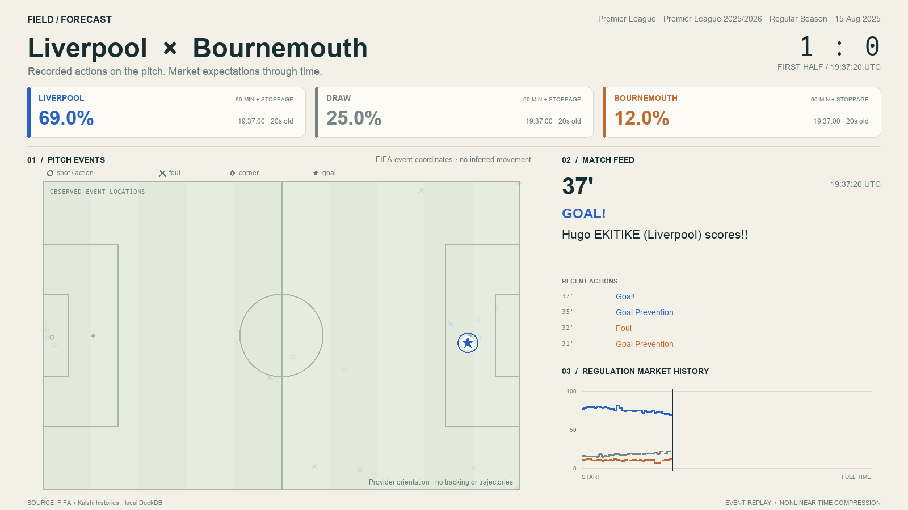
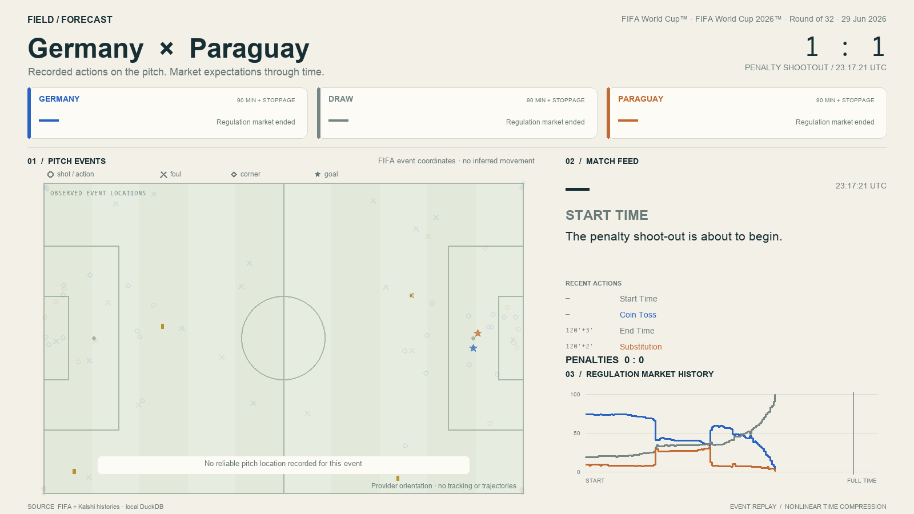

# Kalshi ingestion and replay audit

Acquired 13 October 2026 against the existing FIFA snapshot
`20261013T012355-c487c002` (380 Premier League 2025/26 and 104 World Cup 2026 matches).
Implementation instructions are in the [Kalshi guide](../../docs/pipelines/kalshi.md).

## Regulation-outcome validation

The independently verified home/draw/away dataset is published locally under
`data/processed/fifa-kalshi`, snapshot `20261013T171614-0238aa0a`, using mapping
policy `kalshi-fifa-v2`. Its `current.json` selects this completed snapshot.

| Measurement | Result |
| --- | ---: |
| FIFA matches | 484 |
| Complete Kalshi regulation triplets | 479 |
| Premier League triplets | 375 / 380 |
| World Cup triplets | 104 / 104 |
| Priced binary contracts | 1,437 |
| Yes/No price rows | 455,536 |
| Market + price Parquet bytes | 2,761,705 |
| Raw API responses hash-verified | 1,442 |
| Settlement disagreements with FIFA regulation score | 0 |
| Replay score mismatches | 0 |

Yes and No rows represent complementary sides of the same binary contract;
they are not independent trade observations. Histories contain observed completed
one-minute trade closes, with no previous-price forward fill.

The five excluded Premier League events have a rule/ticker date that differs
from FIFA's fixture date. They remain in the raw cache and exclusion audit:

- `KXEPLGAME-26MAY17AVLLFC`
- `KXEPLGAME-26MAY02AVLTOT`
- `KXEPLGAME-26MAY02BOUCRY`
- `KXEPLGAME-26MAR15ARSEVE`
- `KXEPLGAME-26MAR14CRYLEE`

No date-window widening, liquidity ranking or settlement-based selection was
used to force a match. [Independent verification](hda-verify.json) and the
[484-match replay audit](hda-replay-verify.json) preserve the measured results.

## Broad backfill stopped by request

The broader catalog contained 49,099 raw contracts; the finalized resolver linked
41,630 to FIFA fixtures. The user chose to stop the prop backfill and finalize the
verified regulation dataset because the current simulator consumes home/draw/away.
The final progress message before stopping reported 24,600 contracts processed and
13,211 contracts with prices. These are interrupted-run counters, **not published
dataset coverage**.

The downloaded raw cache is preserved. The incomplete candidate snapshot is
marked interrupted and is not referenced by `current.json`. No partial prop
Parquet file is included in the final dataset. [Backfill status](backfill-status.json)
records the stop and an explicit resume command. The default ingestion command
now selects the two regulation series; `--all-market-types` opts into the broad
backfill and reuses the cache.

## Simulator validation

DuckDB export produced 479 `match_record/v1` records and five explicit exclusions.
The existing default simulator checks produced 7,732 tasks across 468 matches:

| Split | Matches | Tasks |
| --- | ---: | ---: |
| Train: Premier League | 364 | 5,660 |
| Validation: World Cup groups | 72 | 1,432 |
| Test: World Cup knockouts | 32 | 640 |

Of the candidate decision points, 237 were dropped for stale shown prices,
83 for incoherent shown-price sums, 70 for unavailable delayed fills, and 72
for incoherent fill-price sums. All six built-in baselines ran; their complete
output is in [baselines.json](baselines.json). The hindsight policy is an oracle
bound, not an implementable forecast.

These simulations use the existing configurable hypothetical cost and delay
model, not a measured Kalshi fee schedule or evidence of executable fills.
The unchanged Polymarket dataset also exported successfully: 484 records,
zero export exclusions. Venue metadata and namespaced Kalshi task IDs prevent
accidental cross-venue merging.

After finalizing the default dataset, DuckDB import and verification ran again.
The regenerated records and task files match the previously validated baseline
inputs byte for byte; their hashes and configuration are retained in
[simulation-inputs.json](simulation-inputs.json).

## Granular trades and Becker compatibility

A second real ingestion fetched trade-level histories for Germany–Paraguay,
FIFA match `400021513`, across its three regulation contracts. It produced
149,810 Yes/No rows (74,905 retained timestamped observations), verified 91 raw
responses and generated all 20 standard tasks for that match with no decision
drops. [Trade verification](trades-verify.json) records those checks. The Parquet
files total 999,574 bytes in `data/processed/fifa-kalshi/trades-check`.

[Jon Becker's source repository](https://github.com/jon-becker/prediction-market-analysis)
was reviewed for its Kalshi schema and API client. The implementation supports
existing Becker trade Parquet files, including cents-to-probability conversion;
a real small Parquet fixture tests that adapter. The approximately 36 GiB bulk
archive was not downloaded. This audit's real histories came from the official
Kalshi API.

## Visual evidence

Liverpool–Bournemouth shows the Kalshi source label and strictly preceding
regulation prices:



Germany–Paraguay suppresses regulation odds when the match reaches penalties:



An eight-second H.264 replay smoke test also rendered at 1600×900, 24 fps
(192 frames), under the ignored `artifacts/fifa-replay/kalshi-smoke` directory.

## Commands executed

Commands were run in `rin-gym-replay` with its `.venv/bin/python`; the FIFA source
was supplied as `../rin-gym-fifa-pipeline/data/processed/fifa`. The public guide
uses the portable `data/processed/fifa` layout instead.

```sh
.venv/bin/python -m pipelines.kalshi.ingest --dataset ../rin-gym-fifa-pipeline/data/processed/fifa --offline
.venv/bin/python -m pipelines.kalshi.verify --dataset data/processed/fifa-kalshi --fifa ../rin-gym-fifa-pipeline/data/processed/fifa --cache data/raw/kalshi
.venv/bin/python -m app.replay import --dataset ../rin-gym-fifa-pipeline/data/processed/fifa --markets data/processed/fifa-kalshi --database data/kalshi-replay.duckdb --replace
.venv/bin/python -m app.replay verify --database data/kalshi-replay.duckdb
.venv/bin/python -m app.replay export-records --database data/kalshi-replay.duckdb --output data/processed/trade_env-kalshi/records.jsonl.gz
.venv/bin/python -m app.trade_env build-tasks --records data/processed/trade_env-kalshi/records.jsonl.gz --output data/processed/trade_env-kalshi/tasks.jsonl.gz
.venv/bin/python -m app.trade_env baselines --tasks data/processed/trade_env-kalshi/tasks.jsonl.gz --json
.venv/bin/python -m pipelines.kalshi.ingest --dataset ../rin-gym-fifa-pipeline/data/processed/fifa --history trades --series KXWCGAME --match-id 400021513 --output data/processed/fifa-kalshi/trades-check --workers 1
.venv/bin/python -m pipelines.kalshi.verify --dataset data/processed/fifa-kalshi/trades-check --fifa ../rin-gym-fifa-pipeline/data/processed/fifa --cache data/raw/kalshi
.venv/bin/python -m app.replay render --database data/kalshi-replay.duckdb --match 400021513 --output artifacts/fifa-replay/kalshi-smoke --max-seconds 8
.venv/bin/python scripts/check_tests.py
```

The test suite covers exact fixture identity, rule subjects, duplicate/conflicting
contracts, props containing misleading `at least`/`at the end` phrases, malformed
dates, rate-limit backoff, pagination failure, candle/trade units, no forward fill,
semantic Parquet corruption, atomic publication failure, portable FIFA lineage,
mixed-venue rejection and the import/export/task/baseline path.

The complete test command ran 188 tests successfully (one optional training
integration skipped because `tinker-cookbook` is not installed). Ruff and
`git diff --check` also passed. The Polymarket regression generated its existing
9,448 tasks across all 484 matches.
