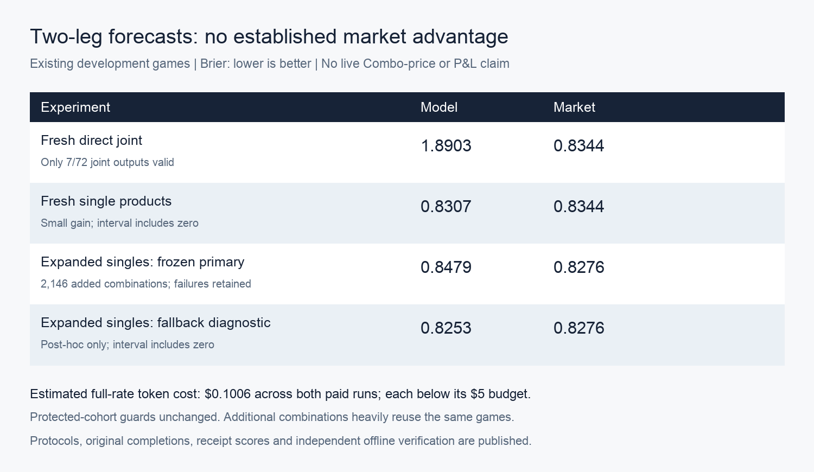

# Parlay experiments: no established advantage over market

This package publishes six experiment stages, including negative results, fixed protocols, complete forecast receipts, per-case scores, verification, and original experiment code. The combined full-rate token-cost estimate for the two paid runs is **$0.1006**; offline stages cost $0. Protected-cohort integrity/exclusion checks stayed unchanged. Existing test/demo games were excluded; protected enrollment remains pending.

| Stage | Finding |
|---|---|
| [Feasibility investigation](parlay-eval-investigation/REPORT.md) | Existing data supports retrospective composition, not observed Combo-price profitability. |
| [Offline two-/three-leg composition](parlay-eval-offline/REPORT.md) | Saved model products underperform market. A positive hypothetical payout subset is not validated trading evidence. |
| [Calibration and score corrections](parlay-eval-improvement/REPORT.md) | Model calibration helps; gains over raw market are unstable. |
| [Active-play contexts](parlay-eval-context/REPORT.md) | Event gating loses to market. Both-games-tied is an exploratory lead. |
| [Fresh joint versus single controls](parlay-eval-fresh-joint/REPORT.md) | Joint output normalization fails; fresh single products show a small, uncertain gain. |
| [Expanded fresh singles](parlay-eval-fresh-singles-expanded/REPORT.md) | Failure-inclusive score loses; a post-hoc market-fallback gain remains uncertain. |

See the [combined experiment history](parlay-eval-investigation/APPROACHES.md).

## Reproduce the published receipt scores offline

From a repository checkout, with Python 3.10+:

```sh
python3 experiments/parlays/verify_results.py
```

This standard-library-only verifier checks every snapshot fingerprint, parses original paid completions under the frozen schema/tolerance, checks receipt counts and budget reservations, independently recomputes the fresh joint and expanded-single Brier scores, and verifies the published holdout guard snapshots agree. It makes no network or inference calls and does not need Tinker credentials, the original local ledger, provider caches or training archives.

The original verifiers' results, including game-level bootstrap checks and prefix leakage checks, are retained alongside each stage. The portable verifier confirms published bytes and fresh-score reproduction; it does not attest a live ledger or independently revalidate unpublished source-release archives. Their original fingerprints are recorded in the protocols.

## Snapshot layout and provenance

`snapshot-manifest.json` maps every original `outputs/...` file to its published path, with hashes for original and published bytes. Large JSON/JSONL files are gzip-wrapped with deterministic compression; decompression gives the exact original bytes. Python caches and progress logs are omitted. No credential files or raw provider-cache release is included.

The `.py` files under the stage directories are original workspace code snapshots. Their roots and recorded commands refer to the original multi-checkout workspace containing `rin-gym-forecast-only`, `rin-gym-simulation`, frozen releases and training artifacts. They are preserved for audit and full workspace reconstruction, not advertised as repository-local entry points. Use the portable verifier above to reproduce published receipt scores. Detailed full-workspace commands remain in each report.

Paid run markers and completed records are retained. Do not remove `STARTED.json` or run the paid scripts to reproduce these reports. The portable verifier is sufficient and never invokes them.

All findings are retrospective development evidence from previously inspected games. Overlapping tickets, repeat calls and shared teams are not independent samples. The 2,146 added combinations include only six new fixture IDs. No live Combo quotes, fills or trading P&L were tested.


