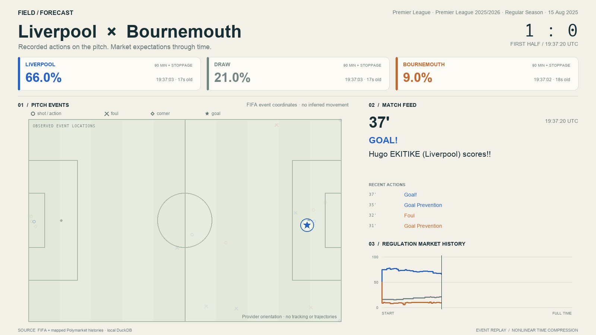
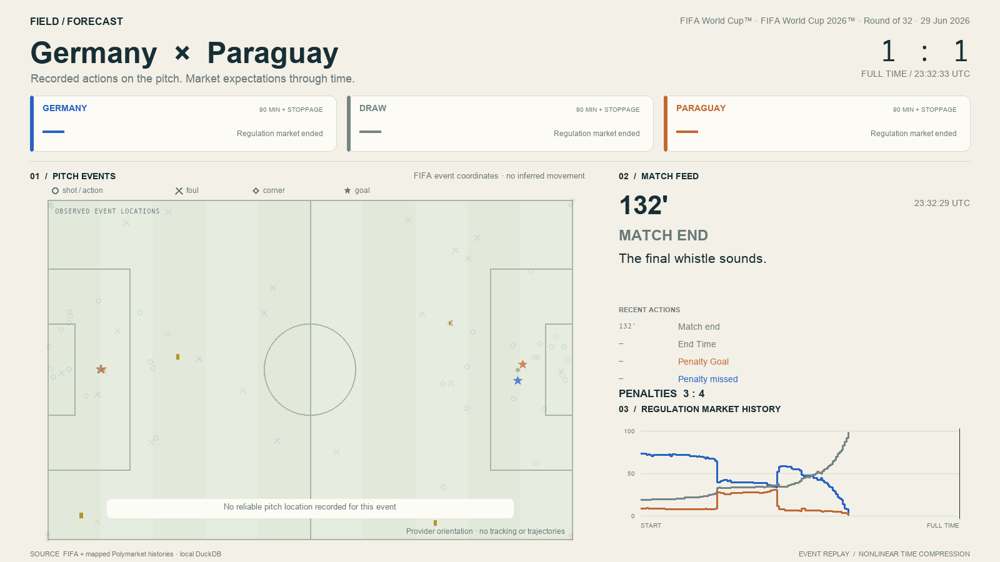

# DuckDB-backed arbitrary-match replay

Imported the current local FIFA and mapped-odds snapshots into DuckDB:

| Table | Rows |
| --- | ---: |
| matches | 484 |
| events | 40,848 |
| markets | 42,746 |
| prices | 16,035,880 |

These counts use the main thread's newer contract-validation output, pinned at
import. Rebuilding explicitly selects a newer snapshot. The local DuckDB file is
374,091,776 bytes (about 374 MB), including original metadata and materialized
prices. The database is not committed.

All **484 matches** loaded and reconstructed to their recorded final score with
**zero mismatches**; all had mapped H/D/A odds. This covered **9 extra-time** and
**4 shootout** games. See [coverage.json](coverage.json).

Previews were rendered and visually checked for Liverpool–Bournemouth,
Czechia–South Africa, and Germany–Paraguay. The latter displays penalties
separately and disables regulation odds after the second-half end.





The 1600×900 H.264 video path was exercised using an eight-second, 12-fps clip.
Automated tests cover database import/query, missing odds, score chronology,
locations, extra time, shootouts, stale prices, ambiguous contracts, source
hashes, and failed-import preservation.

Commands run from this checkout, with the sibling dataset available:

```sh
.venv/bin/python -m app.replay import --dataset ../rin-gym-fifa-pipeline/data/processed/fifa --markets ../rin-gym-fifa-pipeline/data/processed/fifa-market-history --database data/replay.duckdb
.venv/bin/python -m app.replay list-matches --database data/replay.duckdb --search Liverpool
.venv/bin/python -m app.replay render --database data/replay.duckdb --match zhs8gg1hvcuqvhkk2itb54pg --output artifacts/fifa-replay/liverpool-bournemouth --preview
.venv/bin/python -m app.replay render --database data/replay.duckdb --match 400021440 --output artifacts/fifa-replay/czechia-south-africa --preview
.venv/bin/python -m app.replay render --database data/replay.duckdb --match 400021513 --output artifacts/fifa-replay/germany-paraguay --preview
.venv/bin/python -m app.replay render --database data/replay.duckdb --match zhs8gg1hvcuqvhkk2itb54pg --output artifacts/fifa-replay/liverpool-video --max-seconds 8 --fps 12
.venv/bin/python -m unittest discover -s tests/replay -v
.venv/bin/python -m unittest discover -s tests/fifa -v
ruff check app/replay tests/replay
.venv/bin/python -m app.replay verify --database data/replay.duckdb
```
