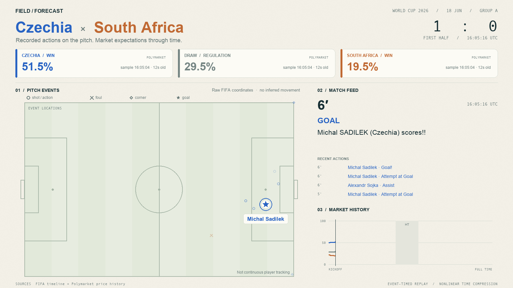

# World Cup event replay

The application animates Czechia–South Africa with recorded event locations, named action markers, the score, a match feed and historical home-win/draw/away-win prices. It is a factual replay rather than a learned simulator.

## Run

Use Python 3.11+, FFmpeg with libx264 support on your PATH, and either macOS Arial/Andale fonts or Linux DejaVu Sans/Mono fonts.

```sh
python3 -m venv .venv
source .venv/bin/activate
python3 -m pip install -r app/replay/requirements.txt
python3 -m app.replay.render --preview
python3 -m app.replay.render
```

Preview mode writes still frames without requiring FFmpeg. The full command produces a silent, approximately 124-second H.264 video at 1600 × 900 and 24 fps. Set `RIN_REPLAY_OUTPUT` to override the output directory.

The small committed fixture in `data/examples/world-cup/czechia-south-africa/` makes the demo work offline. Each source payload has URL/hash metadata. The renderer does not require the full ignored download cache.

## Files and limitations

- Source: `app/replay/render.py`.
- Inputs: `data/examples/world-cup/czechia-south-africa/`.
- Outputs: `artifacts/world-cup-replay/`.
- Detailed encoding and provenance: [artifact notes](../../artifacts/world-cup-replay/README.md).

Only 63 of this match's 94 events have coordinates. Missing locations are not invented, including the penalty goal. Old markers represent historical actions rather than simultaneous player positions. Price cards and the stepped chart use only samples at or before the displayed UTC time and show sample age. These are market prices, not model forecasts; a temporal relationship is not proof of causation or live tradability.



[Download the replay](../../artifacts/world-cup-replay/czechia-south-africa-replay.mp4)
