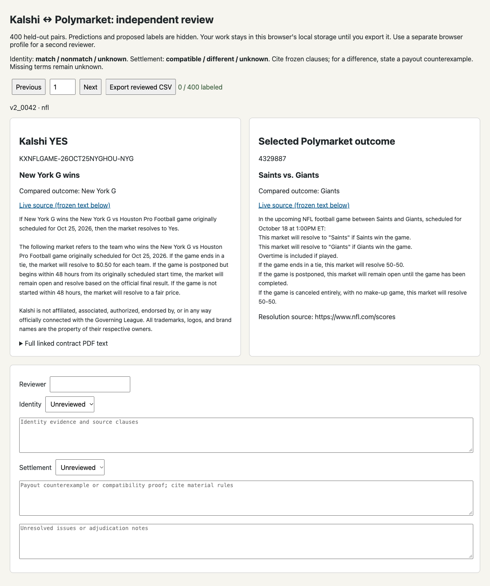

# Kalshi–Polymarket market-resolution evidence

This directory preserves three research snapshots collected on October 13, 2026, and packaged for review on October 15. It adds research evidence and offline verification; it does not change the trading application or place orders.

## Current finding and limits

The first real-market pilot suggested that a heuristic/Jev hybrid reduced review work. After repairing the heuristic parser, the 400-pair event holdout produced **identical heuristic and hybrid decisions**. The hybrid's ten settlement calls added no decisions. This is a comparison of outputs, not proof that either method was correct.

**Independent labels and a valid general-purpose LLM arm remain pending.** No held-out precision, recall, false-accept rate, or four-way winner has been established. Advertised event/outcome identity and equivalent settlement payouts are separate tasks. No settlement-compatible pair was accepted in the 400-pair run.

| Snapshot | Scope | Main evidence |
|---|---|---|
| [Synthetic smoke test](market-entity-resolution/REPORT.md) | 24 hand-authored pairs and four post-hoc diagnostics | 23/24 initial relationship labels; date-normalization and exception-payout sensitivity. Not real exchange validation. |
| [Real-market pilot](market-entity-resolution-real/REPORT.md) | 60 selected real pairs, including 26 advertised overlaps | Hybrid retained 19 accepted identities, cut reviews from 21 to 10, and used 27 rather than 60 calls. Labels were investigator-authored; zero observed false accepts is not established production precision. |
| [400-pair event holdout](market-entity-resolution-v2/REPORT.md) | 400 new outcome-specific pairs across 67 anchor events | Improved heuristics and hybrid both accepted 90 identities and rejected 310. Raw Jev accepted 28, rejected 188, and abstained on 184. These are decision counts, not correctness counts. |

The holdout contains NFL, NBA, NHL, MLB, and Bitcoin point-price candidates selected from bounded public catalogs. Events previously evaluated in the pilot were excluded; rule templates were shared. It is not a prospective time holdout, an unseen-template benchmark, or a representative deployment sample. The 400 pairs are not 400 independent events.

## Budget and incomplete LLM comparison

The milestone's shared **$5 cap** was enforced by a persistent, transactional request-reservation ledger before model requests. The 410 Jev/hybrid responses imply **$0.07260897** at the recorded published rates, leaving **$4.92739103** in that experiment. This is usage-derived accounting, not an independently verified provider invoice. See the [budget summary](market-entity-resolution-v2/budget-summary.json) and [readable ledger export](market-entity-resolution-v2/budget-ledger.json).

Credential-free LLM fallbacks were investigated with the AgentCash plugin. One gateway returned invalid contract summaries; another failed before payment/inference because its payment requirements were incomplete. No valid LLM assessment results or wallet payments were recorded. Failed probes are preserved as evidence rather than substituted for a completed LLM arm. No new model calls were made while packaging this PR.

## What is saved

Reports, protocols, source scripts, review CSVs, metrics, thresholds, freezes, and the ledger export are readable in the directories above. Each exact snapshot is also stored as a deterministic compressed archive under [archives/](archives/), including the public API payloads, extracted contract PDFs/text, frozen pairs, raw model responses, review HTML, and original SQLite budget ledger. Python caches and transient `.tmp` files are excluded. Failed public-download payloads are preserved.

The [archive index](archives/index.json) records each archive's SHA-256 and size. Per-archive manifests record every member's original bytes, SHA-256, and relative path. The verifier checks archive hashes, exact membership, safe relative paths, per-file hashes, and equality with the readable copies. Original files are preserved byte-for-byte, including older machine-specific example paths; use the portable commands below for verification.

The capture includes public exchange records and their rule sources, not exchange account credentials. Pattern scanning and a review of the SQLite fields found no stored API keys, authorization headers, GitHub tokens, or private keys. Model transports load credentials at runtime; no environment or authentication files are included.

## Verify offline

From the repository root, using Python 3.10 or newer:

```sh
python3 research/market-resolution/verify_evidence.py --run-checks
```

This verifies all three archives, extracts them into a temporary directory, and runs the holdout integrity audit and eight offline tests. It makes no network requests, requires no API key, and incurs no model cost. It does not retrain or rerun inference.

To keep an extracted working copy in a new directory:

```sh
python3 research/market-resolution/verify_evidence.py --extract /tmp/market-resolution-evidence --run-checks
```

The extraction destination must be absent or empty. The archive verifier rejects traversal, links, duplicate members, and membership/hash mismatches.

## Independent review

Give reviewers the [blinded CSV](market-entity-resolution-v2/review-blind.csv) and [review instructions](market-entity-resolution-v2/REVIEW.md). The extraction command also restores `market-entity-resolution-v2/review.html`, which shows frozen rule text, hides method predictions, and exports reviewer CSVs. Keep reviewers away from the reports and prediction files until labels are completed. Use separate copies/browser profiles for independent reviewers and explicitly adjudicate disagreements.

The saved scorer requires reviewer/evidence fields, treats unknown references separately, refuses blank reference sheets, and marks whether a four-way comparison is complete. A valid LLM credential/provider and independently adjudicated labels are the remaining inputs; the existing experiment cap must not be reset when continuing it.

The preserved reviewer page was opened from localhost and checked with both label fields blank and `0 / 400 labeled`. The temporary server was stopped after capture. Some links inside the original reports refer to files restored by archive extraction.


